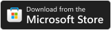
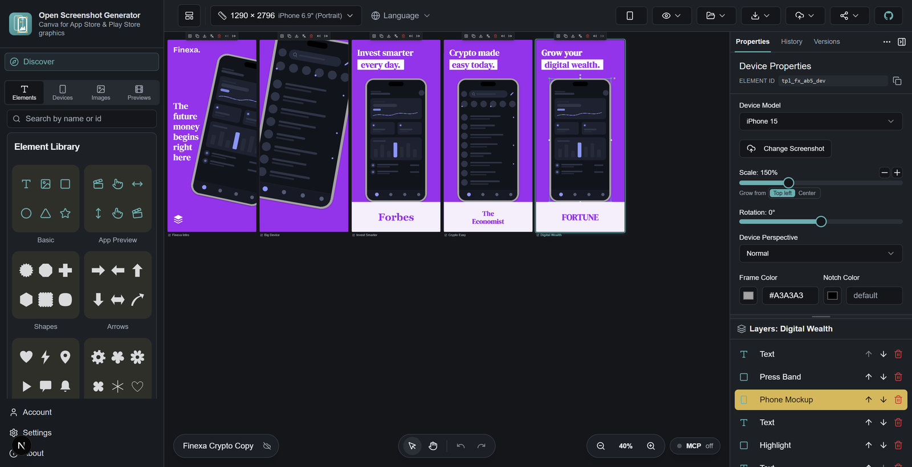
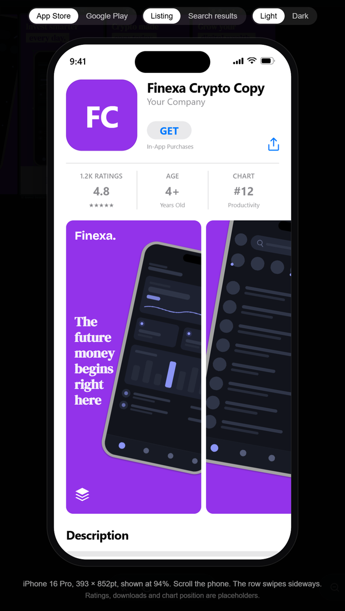

# Open Screenshot Generator

[](LICENSE)
[](https://github.com/dotnetdreamer/open-screenshot-generator/releases/latest)

Make screenshots and preview videos for the App Store and Google Play. Start with a template, add screenshots of your app, change the text and colors, then export the finished files at store sizes.

Open the [web editor](https://editor.openscrgen.app) or [watch the walkthrough](https://youtu.be/gfABjk1Q_Z0?si=uWIIoq1cgQIQSgud). The desktop app is free for Mac, Windows and Linux:

<p align="center">
  <a href="https://apps.apple.com/app/id6822657542"></a>
  &nbsp;&nbsp;
  <a href="https://apps.microsoft.com/detail/9nt28z42qkcd"></a>
  &nbsp;&nbsp;
  <a href="https://github.com/dotnetdreamer/open-screenshot-generator/releases/latest"></a>
</p>

<p align="center"><sub>The Mac App Store version can't run Claude Code or Codex. For Claude Code or Codex on a Mac, get the app from GitHub.</sub></p>

<div align="center">

https://github.com/user-attachments/assets/1b1d7ff4-5f89-4fc5-8e48-efbe89782562

</div>

## What's new

### 19 November 2026: App icon

Design your app's icon on the canvas, starting from your app's name and colours or from your logo. See how the icon looks on an iPhone, an Android phone and a Mac, in light, dark and tinted mode and at actual size. The app tells you if anything will be hard to see or cut off. Then save every size for iPhone, Android, Google Play and the Mac in one go. In the desktop app, you can put the new icon straight into your app's folder. Read [how the app icon works](docs/APP-ICON.md).

### 19 November 2026: Remove background

Cut people, products and logos out of photos for your screenshots, right on your computer, even offline once the model is downloaded. On a Mac it starts with your Mac's own cut-out, and you can fix any edge with a brush. Everything you cut out waits in the new **Custom** tab, ready for any project, and backs up to your Google Drive or GitHub. Read [how Remove background works](docs/REMOVE-BACKGROUND.md).

### 17 November 2026: Every device

Make your screenshots once and see them laid out again for the iPad, Android phones and tablets, and the Mac. Pick another layout for any screenshot, add an iPad or Mac screenshot where a device needs its own, and export every set with your project. Read [how Every device works](docs/DEVICES.md).

### 15 November 2026: Growth, Capture and a website for your app

See your App Store and Google Play downloads, ratings and reviews in [Growth](docs/GROWTH.md), keep an eye on competing apps and see where your app shows up in App Store search. In the desktop app, [Capture](docs/CAPTURE.md) takes screenshots of your app in every language, right from your computer or Android phone. [Website](docs/WEBSITE.md) makes your app's home, support and privacy pages and puts the pages online for free on GitHub.

### 14 October 2026: Codex joins Claude Code in the desktop app

The desktop app's AI agent can now run in Codex as well as Claude Code. Claude Code uses your Claude plan and Codex uses your ChatGPT plan, so you don't need an API key. Pick one on the agent screen or in the **Agent** tab, and watch it build your design. Read the [Claude Code](docs/AI-AGENT.md#4-claude-code-mode-the-agent-edits-the-live-project) and [Codex](docs/AI-AGENT.md#5-codex-mode-the-same-live-editing-on-a-chatgpt-plan) guides.

### 29 September 2026: New CLI

You can now make store images from a terminal or a script with `npx open-screenshot-generator`. It can also connect its design tools to a coding agent. [Start with the CLI](#command-line-and-coding-agents).

Recent additions also include a second window for the right panel, project versions, live editing with others, cloud saving, translations, imported fonts, and direct store uploads from the desktop app.

## What it does

1. Open a template or a blank canvas.
2. Add your app screenshots to the device frames.
3. Edit the text, images, colors, and layout. You can make several designs in one project.
4. Preview how the set looks in a store listing, then export the sizes you need.

You can also:

- Choose from 103 templates for app screenshots, Apple Watch, Mac, preview videos, and Google Play feature graphics.
- Make one layout for several languages and edit each language's text and screenshots.
- See your design laid out again for the iPad, Android tablets and the Mac, and export every set at once.
- Make preview videos from a screen recording.
- Take screenshots of your app straight from the iPhone Simulator or an Android emulator, in every language, in the desktop app.
- Ask the AI agent to pick a template, place screenshots, and draft text.
- Save versions of your project, share a copy, or invite others to edit with you.
- Upload finished screenshots to App Store Connect or Google Play from the desktop app.
- See your app's App Store downloads, conversion, reviews and listing problems, and whether your new screenshots sold better, in the desktop app.
- See where your app ranks in App Store search for the words you pick, every day, and add missing words to your store page.
- Make a website for your app, with a support page and a privacy policy in every language, and put it online on your own GitHub account.

## A closer look

<p align="center">
  
</p>

The canvas holds all your designs together. Choose an item to change it in the right panel. The export dialog checks store sizes, and the listing preview shows your images as shoppers will see them.

<p align="center">
  
</p>

## How it compares

Open Screenshot Generator is free and open source, with no watermark or export cap. You can use it without an account and save projects locally. [Compare it with other screenshot tools](https://openscrgen.app/compare) on one page, with their prices and what each one does best. The site also has longer comparisons with [AppScreens](https://openscrgen.app/appscreens-alternative), [Previewed](https://openscrgen.app/previewed-alternative), [AppMockUp](https://openscrgen.app/appmockup-alternative), and [Smartmockups](https://openscrgen.app/smartmockups-alternative).

## Feature checklist: web vs desktop

Both versions use the same editor. The desktop app adds features that need access to your computer or developer accounts.

| Feature | Web editor | Desktop app |
| --- | --- | --- |
| Templates, design tools, languages, store size PNG export | Yes | Yes |
| Every device: your design laid out for iPad, Android and Mac sizes | Yes | Yes |
| App icon: one design, every size for iPhone, Android, Mac and the stores | Yes, as a zip | Yes, as a zip, a folder or straight into your app's folder |
| Preview video export | In Chrome or Edge | Yes |
| AI agent with your own API key | Yes | Yes |
| AI agent with an existing assistant account | Copy and paste, or use the [companion extension](extension/README.md) | Built in assistant window |
| Built in or local AI providers | No | Yes |
| AI agent in Claude Code or Codex, on your Claude or ChatGPT plan | No | Yes, except the Mac App Store version |
| Coding agent design tools | With the [web relay](infra/vps/mcp-relay/README.md) or CLI | Built in MCP server |
| Save to your own Google Drive or GitHub account | Yes | Yes |
| Upload screenshots directly to App Store Connect or Google Play | No | Yes |
| Capture: screenshots and recordings from the iPhone Simulator, Android emulators and phones | No | Yes |
| Remove background: people and products cut out of photos on your computer, a Custom tab of your own pictures, backed up to Google Drive or GitHub | Yes | Yes, plus your Mac's own cut-out on macOS 14 and later |
| Growth: App Store and Google Play numbers, reviews, store page checks, results of new screenshots | Empty screens only | Yes |
| Growth: competitors' screenshots, ratings, versions and prices in each country, with alerts for new screenshots | App Store apps | App Store and Google Play apps |
| Growth: your rank in App Store search for each keyword, every day, with ideas for more keywords | Yes | Yes |
| Website: home, support and privacy pages, put online with your GitHub account | Yes, with a GitHub token until the sign-in service asks for public repositories | Yes |
| Store compliance: why the stores turn apps down and how to fix it, explained in plain words, plus a checklist before review, the dates new laws and store rules start, and an AI check of your screenshots' words | Yes (the AI check needs an AI set up in the AI panel) | Yes |

## Command line and coding agents

The CLI needs Node 20.12 or newer and Chrome, Edge, or Chromium. Put screenshots of your app in a folder called `shots`, then run:

```bash
npx open-screenshot-generator doctor
npx open-screenshot-generator init
npx open-screenshot-generator fill --screenshots ./shots
npx open-screenshot-generator render
npx open-screenshot-generator verify
```

`fill` chooses a template and places your screenshots. `render` makes the image files, and `verify` checks them against store rules. [More CLI commands](cli/README.md)

To connect the design tools to a coding agent, run:

```bash
npx open-screenshot-generator install
```

The package includes [skills for common store asset tasks](skills/README.md). In Claude Code, you can install the plugin with:

```text
/plugin marketplace add dotnetdreamer/open-screenshot-generator
/plugin install open-screenshot-generator@open-screenshot-generator
```

## Running it locally

You need Node 18.18 or newer to run the web editor from this repository.

```bash
git clone https://github.com/dotnetdreamer/open-screenshot-generator.git
cd open-screenshot-generator
npm install
npm run dev
```

Open <http://localhost:9002>. Choose a template or start blank. Local design and export work without a backend. The community feed and cloud saving need the [optional backend](infra/vps/README.md).

## App Store preview videos

Choose **App Preview Videos** on the start screen, pick a template, and add a screen recording to its phone frame. Change the text and timing on the timeline, then export an MP4.

For App Store Connect, choose an export based on your screen recording. The styled video option includes the background and phone frame and is intended for other uses, such as a website or social post. MP4 export needs Chrome, Edge, or the desktop app.

## The AI agent

On the start screen, choose the AI agent, add screenshots, and describe the design you want. You can review and edit the project it makes. Choose your own API key, an assistant account you already use, or one of the desktop app's built in providers. The desktop app also offers Claude Code and Codex, the first two choices on that screen: if one is installed and signed in on your computer, the agent uses your Claude or ChatGPT plan, builds the design in a new project while you watch, and stays in the **Agent** tab of the right panel for more changes. The [AI agent guide](docs/AI-AGENT.md) explains these choices.

## Storage and templates

Projects are saved on your device by default. Clearing the browser's site data removes its local projects, so keep a copy of work you want to preserve. If you sign in, you can save projects to the app's cloud service. You can also connect [your own Google Drive or GitHub account](docs/ACCOUNT-SYNC.md).

Templates are JSON files in [public/data/projects/](public/data/projects/). To add one, follow the steps in [CONTRIBUTING.md](CONTRIBUTING.md).

## Loose ends worth knowing about

- The web editor needs Chrome or Edge for MP4 export. PNG export works in other browsers.
- `npm start` starts the development server. Use `npm run build` to make a production build.
- Contributors should run `npm run typecheck` and the [end to end tests](tests/e2e/README.md). The build does not check types, and the lint script currently opens a setup prompt.

## Contributing

Issues and pull requests are welcome. See [CONTRIBUTING.md](CONTRIBUTING.md) for setup and template instructions.

## License

The code is available under the [MIT License](LICENSE). Bundled images and other assets have separate licenses. Read [THIRD-PARTY-ASSETS.md](THIRD-PARTY-ASSETS.md) before copying or redistributing them.
